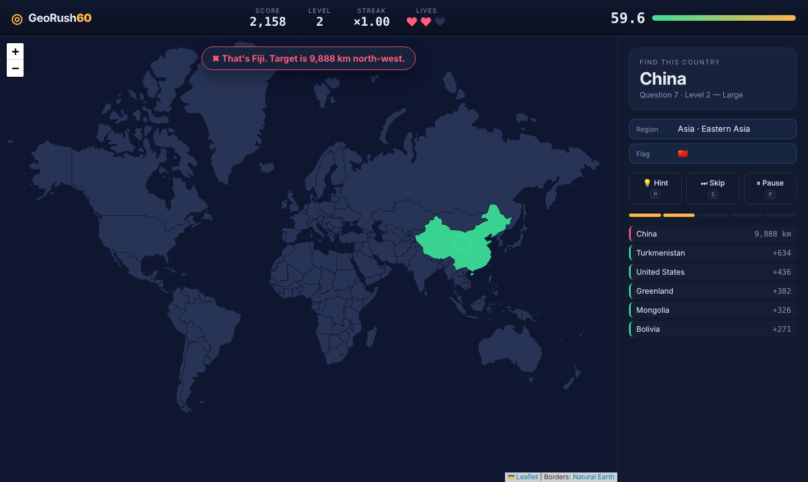
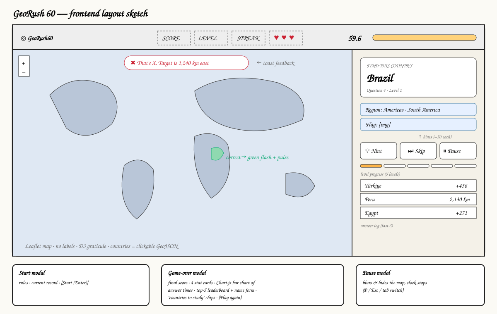
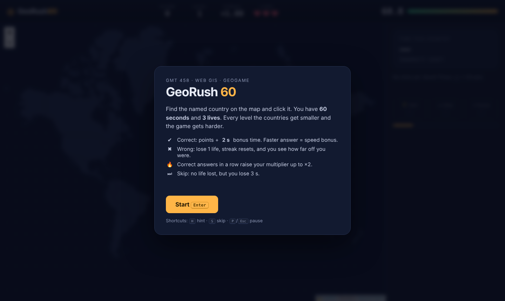
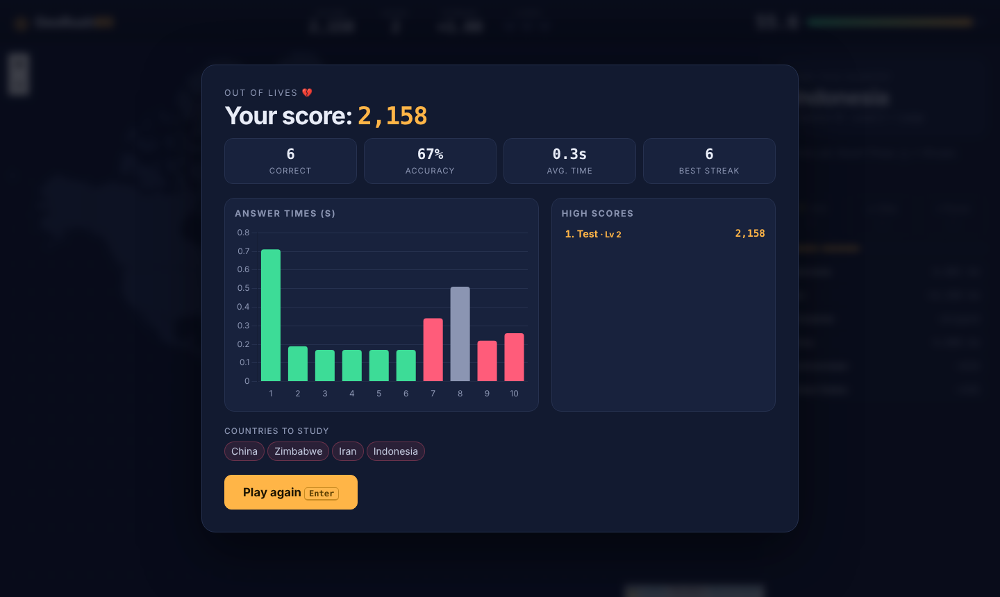

# 🌍 GeoRush 60 — Find the Country Before the Clock Runs Out

**GMT 458 – Web GIS · Assignment 2: GeoGame**

🎮 **Play online:** https://YOUR-GITHUB-USERNAME.github.io/georush60/  
📦 **Repository:** https://github.com/YOUR-GITHUB-USERNAME/georush60



---

## 1. Game description

GeoRush 60 is a fast, browser-based geography game. A country name appears in the side panel and the player must **click that country on a world map** as quickly as possible. The player has **60 seconds** and **3 lives**. Every correct answer gives points and extra time; every wrong answer costs a life and shows **how far (km) and in which direction** the real country was. As the player progresses, the game moves through 5 difficulty levels: countries get smaller and, in the last level, the borders disappear.

Geography is the core of the gameplay, not decoration:
- the answer is a **location** (a polygon on the map), not a multiple-choice text option;
- the feedback is **spatial**: great-circle distance and compass direction between the clicked country and the target, both computed on a sphere with D3;
- difficulty is driven by a **geographic attribute** (country area in km²).

## 2. Functional requirements

| # | Requirement |
|---|---|
| FR1 | The game shows a start screen with the rules, keyboard shortcuts and the current record. |
| FR2 | A world map (Leaflet) is shown **without any basemap labels** (only country polygons + a D3 graticule), so the map never gives away the answer. |
| FR3 | Each question shows one target country name. |
| FR4 | The player answers by clicking a country polygon. Clicking the ocean gives a gentle warning, no penalty. |
| FR5 | A 60-second countdown is always visible as a number and a progress bar; it turns red in the last 10 s. |
| FR6 | Correct answer → points, +2 s, green flash, toast message. |
| FR7 | Wrong answer → −1 life, streak reset, red flash on the clicked country, green pulse on the real one, distance + direction message. |
| FR8 | The player can ask for up to 3 hints per question (region → flag → capital), each costs 50 points. |
| FR9 | The player can skip a question (no life lost, −3 s). |
| FR10 | The game can be paused (button, `P`, `Esc`, or automatically when the browser tab is hidden). The map is hidden while paused. |
| FR11 | Difficulty increases every 5 correct answers (5 levels). |
| FR12 | The game ends when time runs out **or** lives reach 0. |
| FR13 | The game-over screen shows the score, accuracy, average answer time, best streak, a chart of answer times, the countries to study and a top-5 leaderboard. |
| FR14 | The player can save their name to a leaderboard that persists in the browser (`localStorage`). |
| FR15 | The layout works on desktop and on narrow (mobile/tablet) screens. |

## 3. Frontend layout (sketch)



```
┌──────────────────────────────────────────────────────────────────────────┐
│ ◎ GeoRush60      SCORE LEVEL  STREAK ♥♥♥                 59.6 ████████░ │  ← HUD
├───────────────────────────────────────────────────┬──────────────────────┤
│  [+]           ( toast: ✖ Target is 1,240 km east )  │  FIND THIS COUNTRY   │
│  [-]                                               │  ██ Brazil ██        │
│                                                    │  Question 4 · Lvl 1  │
│              LEAFLET WORLD MAP                     ├──────────────────────┤
│        (no labels, clickable countries)            │  hints (region/flag/ │
│                                                    │  capital)            │
│                                                    │  [Hint][Skip][Pause] │
│                                                    │  ▬▬ ▬▬ ▭▭ ▭▭ ▭▭ level│
│                                                    │  answer log (last 6) │
└───────────────────────────────────────────────────┴──────────────────────┘
 Overlays:  Start modal · Pause modal · Game-over modal (chart + leaderboard)
```

| Start | Game over |
|---|---|
|  |  |

## 4. How the game progresses

The game uses **both** time-based progression and increasing complexity.

| Level | Name | Country pool | Extra difficulty |
|---|---|---|---|
| 1 | Giants | area ≥ 1,000,000 km² (30 countries) | — |
| 2 | Large | area ≥ 300,000 km² (73) | — |
| 3 | Medium | area ≥ 100,000 km² (109) | — |
| 4 | Everyone | all 172 countries | — |
| 5 | Expert | small countries, < 150,000 km² | **country borders are hidden** |

- The player moves up **one level after every 5 correct answers**.
- A country is never asked twice in the same game.

## 5. Number of questions

There is **no fixed number of questions** — the player answers as many as they can within the time limit. Because correct answers add +2 s, a good player can keep the game going longer than 60 s. In practice a game has about 10–35 questions. The dataset contains **172 countries**, so the game never runs out of questions.

## 6. Lives

The player starts with **3 lives (♥♥♥)**. A wrong click costs 1 life. Skipping does not cost a life. At 0 lives the game ends immediately.

## 7. Scoring and high-score mechanism

For every correct answer:

```
points = (100 × level + speedBonus) × streakMultiplier
speedBonus       = max(0, (8 − answerSeconds) × 15)      → up to +120 for a very fast answer
streakMultiplier = 1 + 0.25 × min(streak, 4)            → ×1.00, ×1.25, ×1.50, ×1.75, ×2.00
```

- Each hint: **−50 points** (score never goes below 0).
- Wrong answer or skip: **streak resets** to ×1.00.
- **High scores:** the top 5 scores (name, score, reached level, date) are stored in the browser with `localStorage`. If the score is good enough, the game-over screen shows a name form. The current record is shown on the start screen.

## 8. Temporal component

Time is the main pressure in the game:

- **60-second global countdown** (shown as numbers with one decimal and as a progress bar that turns red in the last 10 s).
- **+2 s** for each correct answer, **−3 s** for each skip → good play directly "buys" more time.
- **Speed bonus:** the faster the answer (under 8 s), the more points.
- Answer time for each question is measured and shown at the end in a **Chart.js bar chart** (green = correct, red = wrong, grey = skipped), so the player can see where they were slow.
- The clock **stops during feedback animations** (so animations are not unfair) and while the game is **paused**. Paused time is not counted as answer time. If the player switches to another browser tab, the game pauses automatically.

## 9. JavaScript libraries

| Library | Why it is used |
|---|---|
| **[Leaflet 1.9.4](https://leafletjs.com/)** | Interactive map, GeoJSON layer of country polygons, per-country click/hover events, `flyToBounds`, `panTo`, `divIcon` pulse marker. |
| **[D3.js v7](https://d3js.org/) (d3-geo)** | `d3.geoGraticule10()` draws the 10° latitude/longitude grid used as the map background. Spherical geometry: `d3.geoCentroid` for country centroids and `d3.geoDistance` for great-circle distance in the "you were X km off" feedback. A simple planar average would be wrong for large countries (e.g. Russia, Canada). |
| **[Chart.js 4](https://www.chartjs.org/)** | Bar chart of answer times on the game-over screen, coloured by result, with tooltips showing the country and points. |
| `topojson-client` (build step only) | Converts the Natural Earth TopoJSON into GeoJSON in `scripts/build-data.mjs`. |

Basemap: **no tile layer is used on purpose.** Tile basemaps show place names (which would reveal answers) and most of them now require an API key. The map is drawn only from the open country polygons plus a D3 graticule, so the game has no external map service dependency.

## 10. Open datasets

| Dataset | Licence | Used for |
|---|---|---|
| [Natural Earth](https://www.naturalearthdata.com/) Admin-0 countries, 1:110m — via [`world-atlas`](https://github.com/topojson/world-atlas) | Public domain | Country polygons |
| [mledoze/countries](https://github.com/mledoze/countries) — via [`world-countries`](https://www.npmjs.com/package/world-countries) | ODbL | Country names, area (km²), capital, region/sub-region, ISO codes |
| [flagcdn.com](https://flagcdn.com/) | Public domain flags | Flag hint |

`scripts/build-data.mjs` joins the two datasets by ISO numeric code, removes Antarctica, rounds coordinates (smaller file) and **"unwraps" polygons that cross the 180° meridian** (Russia, Fiji) so they don't draw stripes across the Leaflet map. The output is `data/countries.geojson` and `data/countries.js`.

To rebuild the data:
```bash
npm install
npm run build-data
```

## 11. Implementation

### 11.1 Event handlers

At least three event handlers are used (there are five kinds):

1. **Map click / hover on each country (Leaflet `click`, `mouseover`, `mouseout`)** — `makeCountryHandlers()` in `js/game.js`. Clicking a country checks the answer; hovering highlights the country.
   ```js
   layer.on(makeCountryHandlers(feature, layer));
   ```
2. **Keyboard shortcuts (`keydown` on `document`)** — `Enter` start/restart, `H` hint, `S` skip, `P`/`Esc` pause. The handler is ignored while the player is typing in the name input.
3. **Button clicks (`click`)** — Start, Hint, Skip, Pause, Resume, Play again.
4. **Leaderboard form (`submit`)** — `preventDefault()`, reads the name, saves the score, re-renders the list.
5. **Page visibility (`visibilitychange`)** — the game pauses automatically when the tab is hidden, so the timer is fair.

### 11.2 Closures

Closures are used to keep game state **private** and to make the code reusable:

1. **`createCountdown(totalSeconds, onTick, onEnd)`** (`js/utils.js`) — `remaining`, `intervalId` and `lastTick` live inside the closure. The rest of the game can only use `start / pause / resume / add / stop`. Nobody can accidentally set the time to a wrong value.
2. **`createScoreKeeper()`** — `score`, `streak`, `bestStreak` and `history` are private. All scoring rules are in one place (`correct`, `wrong`, `skip`, `penalty`). `history` is returned as a copy, so outside code cannot change it.
3. **`createLeaderboard(storageKey, maxEntries)`** — remembers the `localStorage` key and the list size once; returns `all / best / qualifies / add`.
4. **`makeCountryHandlers(feature, layer)`** — a handler factory. Each of the 172 countries gets its own set of handlers that "remember" their own `feature` and `layer`, so a single generic function serves every polygon.

```js
function createCountdown(totalSeconds, onTick, onEnd) {
  let remaining = totalSeconds;   // private
  let intervalId = null;          // private
  ...
  return { start, pause, resume, add, stop };
}
```

**Benefit:** no global variables for score/time, less risk of bugs, and a new game simply creates new closures (`createScoreKeeper()`, `createCountdown()`), which resets everything cleanly.

### 11.3 Interaction with the DOM

- Elements are selected once with `document.getElementById` and stored in an `el` object.
- **Text updates:** `textContent` for score, level, multiplier, timer, question and question meta.
- **Style updates:** the timer bar width (`style.width`), CSS classes with `classList.add/remove/toggle` (`warn` timer, `bump` and `shake` animations, `hidden` overlays, `flash` question).
- **Creating elements:** hint cards and the answer log are added with `insertAdjacentHTML`; old log items are removed with `lastElementChild.remove()`; the floating "+2s" label is created with `document.createElement` and removed after the animation.
- **Generated HTML:** the lives (♥), level progress bar, summary cards, "countries to study" chips and leaderboard are rendered from data. User input (player name) is escaped with `escapeHTML()` before it goes into the page.
- **Forms & focus:** the name input is focused automatically when a high score is reached.
- **Leaflet styles:** `layer.setStyle()` colours polygons green/red; level 5 changes the border colour of all polygons to hide borders.

### 11.4 Project structure

```
georush60/
├── index.html              # page structure: HUD, map, side panel, 3 overlays
├── css/style.css           # dark theme, layout, animations, responsive rules
├── js/utils.js             # closures: countdown, score keeper, leaderboard + helpers
├── js/game.js              # map, game logic, event handlers, DOM rendering, chart
├── data/countries.geojson  # open data (built)
├── data/countries.js       # same data as a script (works with file:// too)
├── scripts/build-data.mjs  # data pipeline (Natural Earth + mledoze/countries)
└── docs/                   # wireframe and screenshots
```

### 11.5 Running locally

No build tool is needed. Open `index.html` in a browser (or use the VS Code **Live Server** extension).

### 11.6 Online web application (GitHub Pages)

The game is hosted with GitHub Pages: **Settings → Pages → Source: Deploy from a branch → `main` / `(root)`**.  
Live URL: https://YOUR-GITHUB-USERNAME.github.io/georush60/

## 12. What I learned from AI

> ✏️ **Fill this section in yourself.** Write honestly what you asked the AI, what you learned and what you changed, and put the link to the conversation.

- **AI tool:** Claude (Anthropic)
- **Conversation URL:** `PASTE-THE-SHARE-LINK-HERE`
- **What I learned:**
  - *(example)* How closures can hide state (timer, score) instead of using global variables.
  - *(example)* Why a country centroid and the distance between two countries should be computed on a sphere (`d3.geoCentroid`, `d3.geoDistance`) and not with simple lat/lon averages.
  - *(example)* Why polygons crossing the 180° meridian draw stripes in Leaflet and how to "unwrap" their longitudes.
  - *(example)* How to measure time accurately with `performance.now()` instead of counting `setInterval` ticks.
- **What I changed / decided myself:** *(write your own changes here)*

## 13. Credits

- Country boundaries: Natural Earth (public domain)
- Country metadata: mledoze/countries (ODbL)
- Graticule: generated with D3 (`d3.geoGraticule10`)
- Flags: flagcdn.com
- Fonts: Space Grotesk, JetBrains Mono (Google Fonts, OFL)
